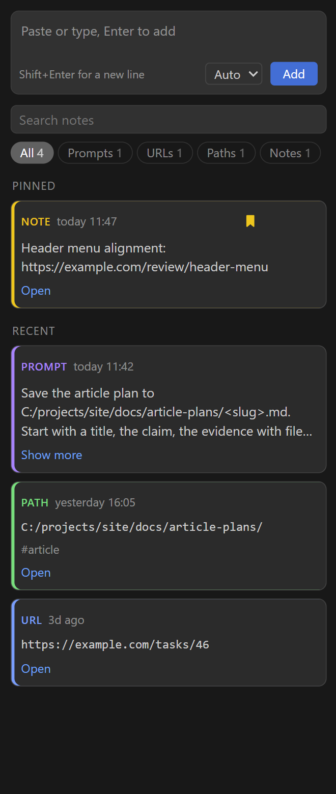

# Scratchpad

Sidebar notepad for prompts, URLs, file paths and notes, shown as cards.

- Notes live in `~/.claude/pad/notes.jsonl` (setting `scratchpad.file` to change).
- Quick-add box at the top: paste, Enter. Shift+Enter for a new line. Type is auto-detected; click a card's type label to change it.
- Click a card to copy it. Prompts with `<placeholders>` ask for a value first (Esc leaves it as is).
- Pin, edit, delete (with Undo), search, filter by type. URL and path cards have Open.
- Also: right-click a file in the Explorer to add its path; right-click a selection to add it.
- Claude Code: the `/pad` skill uses `src/cli.js` on the same file.

Tests: `npm test`.

## Use with Claude Code (optional)

Copy `claude-skill/pad` to `~/.claude/skills/pad`, replace `<path-to-this-repo>` in it with this repo's path, and Claude can add to and query the same file: "add this to the pad", "list the file paths I added yesterday".

Install the extension from a built package: `npx @vscode/vsce package --no-dependencies`, then `code --install-extension scratchpad-vscode-0.2.0.vsix`.
